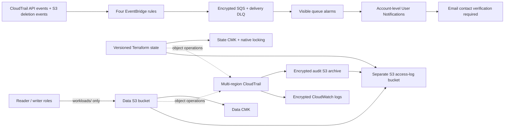

# Secure AWS Platform

[](https://github.com/jayekwere/secure-aws-platform/actions/workflows/terraform-security.yml)

A deployed Terraform AWS security lab demonstrating enforced S3/KMS access boundaries, encrypted audit logging, security-event capture, and protected remote state.

**Scope:** one AWS account and one development environment. Storage and detection resources are regional; CloudTrail collects management events across regions. This is an S3/KMS security foundation, with no application workloads, private network, containers or Kubernetes deployment.

**Deployment, October 26, 2026:** the access, audit, detection and state foundation is applied. The existing data bucket and encryption key were preserved. Reader/writer authorization and real CloudTrail/EventBridge delivery have live evidence. See the [deployment record](docs/phase-2-access-audit-state.md), [live checks](docs/evidence/phase2-live-verification.json) and [state verification](docs/evidence/phase2-state-migration.json). [Latest hosted CI](https://github.com/jayekwere/secure-aws-platform/actions/runs/40389220930) passed all five jobs for `5fda09e`.

## Architecture

Two Terraform roots separate the state/log foundation from the development controls:

- [`terraform/bootstrap`](terraform/bootstrap): protected state bucket, dedicated state CMK and terminal S3 access-log bucket.
- [`terraform/environments/dev`](terraform/environments/dev): data storage, bounded workload roles, audit CMK/archive, CloudTrail, CloudWatch, EventBridge and SQS.



GitHub Actions validates configuration without AWS credentials; it does not deploy. Logs, state and data have separate access boundaries. The S3 access-log destination uses SSE-S3 because AWS requires it for that delivery service; the data, state and audit keys are customer managed.

## Implemented controls and evidence

| Control | Enforced behavior | Source / evidence |
| --- | --- | --- |
| Public exposure and ownership | All four public-access blocks; ACLs disabled; versioning on all four buckets | [Data](terraform/environments/dev/main.tf), [audit](terraform/environments/dev/logging.tf), [foundation](terraform/bootstrap/main.tf), [live queries](docs/evidence/phase2-live-verification.json) |
| Upload encryption and transport | Deny non-service HTTP and uploads missing explicit SSE-KMS/project-key selection | [Bucket policy](terraform/environments/dev/bucket-policy.tf), [request contract](docs/storage-policy-contract.md) |
| Workload access | Reader can read versions; writer can upload/manage multipart uploads; both limited to `workloads/`; neither can delete, access state/audit, or use KMS directly | [IAM](terraform/environments/dev/iam.tf), [live allowed/denied requests](docs/evidence/phase2-live-verification.json) |
| Key management | Explicit named administration, root-only policy recovery, rotation and service/context restrictions; configured 30-day deletion windows and Terraform deletion guards | [Data key](terraform/environments/dev/kms.tf), [shared policy](terraform/environments/dev/security-locals.tf), [audit key](terraform/environments/dev/logging.tf), [state key](terraform/bootstrap/main.tf) |
| Audit logging | Enabled multi-region CloudTrail, integrity validation enabled, encrypted S3/CloudWatch destinations, project data/state object events | [Logging](terraform/environments/dev/logging.tf), [observed delivery](docs/evidence/phase2-live-verification.json) |
| Detection | Four rules capture bucket/key/trail changes and scoped deletions; encrypted queues retain events for 14 days, with a delivery DLQ and queue alarms | [Detection](terraform/environments/dev/detection.tf), [pattern tests](docs/evidence/phase2-event-patterns.json), [live delivery](docs/evidence/phase2-live-verification.json) |
| Remote state | Separate versioned bucket and CMK, named administrator access, exact state-key deletion denies, native lockfile settings; both roots migrated | [Bootstrap](terraform/bootstrap), [backend verification](docs/evidence/phase2-state-migration.json) |
| Retention and cleanup | Incomplete multipart uploads aborted after 7 days; noncurrent data versions expire after 30 days; current logs after 365 days and old log/state versions after 90 days | [Data lifecycle](terraform/environments/dev/lifecycle.tf), [archive](terraform/environments/dev/logging.tf), [foundation](terraform/bootstrap/main.tf) |
| Automated validation | Both roots have mocked plan tests, deliberate regression checks, formatting, validation, TFLint and blocking Checkov | [Workflow](.github/workflows/terraform-security.yml), [test runner](scripts/check_storage_regressions.py) |

The workload roles are assumed by the existing administrator for this demonstration. They are not connected to an application. The administrator can change policies; these controls are not an organizational restriction on that administrator.

## Verification results

| Evidence | Result and limit |
| --- | --- |
| [Initial storage milestone](docs/evidence/storage-live-verification.json) | 20 earlier live checks, including correct-key/multipart requests, different-key and missing-header denials. Historical snapshot; overlaps with later checks. |
| [Current live controls](docs/evidence/phase2-live-verification.json) | 56 checks passed: real role assumptions, allowed/denied requests, storage/key queries and observed encrypted log/event delivery. Synthetic data versions removed; queue events retained. |
| [Remote-state verification](docs/evidence/phase2-state-migration.json) | 16 checks passed: both roots migrated, real lock contention, encrypted locks, previous-version retrieval and final no-change plans. Metadata transitions and excluded probes are recorded. |
| [Dev](docs/evidence/phase2-dev-tests-local.json) and [bootstrap](docs/evidence/phase2-bootstrap-tests-local.json) plan tests | 6 mocked plan runs passed; all 18 deliberate regressions were rejected, including omitted alias-administration permissions. No AWS deployment occurs in these tests. |
| [EventBridge pattern checks](docs/evidence/phase2-event-patterns.json) | 15 positive/negative fixtures passed using AWS's read-only evaluator. Actual delivery has separate live evidence. |
| [Checkov](docs/evidence/phase2-checkov-local.json) and [TFLint](docs/evidence/phase2-tflint-local.json) | Checkov 3.3.30: 123 passed, 0 failed, 9 explicit exceptions, 0 parsing errors. TFLint 0.64.0: both roots clean using Terraform recommended rules. |

Evidence includes timestamps, source revisions and hashes where applicable. A later CI portability repair added HashiCorp-verified Linux checksums to the lockfiles; provider versions and deployed resource configuration did not change. The older `storage-*` evidence and original [reviewed plans](docs/evidence/phase2-plan-review.json) describe their dated snapshots. The [deployment record](docs/phase-2-access-audit-state.md) explains the alias-permission repair and the final configuration.

Current [closeout CI evidence](docs/evidence/foundation-closeout-ci.json) records all five passing jobs, six mocked plan runs and 18 rejected deliberate regressions for `5fda09e`. The [earlier deployment run](docs/evidence/phase2-hosted-ci.json) remains available. The workflow does not use AWS credentials or deploy infrastructure.

## Run the static checks

These checks need Terraform 1.15.8 and provider downloads, but no AWS credentials. Backend initialization is disabled for static validation and the native plan tests use mocked providers.

```sh
terraform fmt -check -recursive terraform
terraform -chdir=terraform/environments/dev init -backend=false -input=false -lockfile=readonly
terraform -chdir=terraform/bootstrap init -backend=false -input=false -lockfile=readonly
terraform -chdir=terraform/environments/dev validate -no-color
terraform -chdir=terraform/bootstrap validate -no-color
python3 scripts/check_storage_regressions.py --root dev
python3 scripts/check_storage_regressions.py --root bootstrap
```

For TFLint 0.64.0 and Checkov:

```sh
tflint --chdir=terraform/environments/dev --init --config="$PWD/.tflint.hcl"
tflint --chdir=terraform/environments/dev --config="$PWD/.tflint.hcl" --format=compact
tflint --chdir=terraform/bootstrap --init --config="$PWD/.tflint.hcl"
tflint --chdir=terraform/bootstrap --config="$PWD/.tflint.hcl" --format=compact
checkov -d terraform --framework terraform
```

TFLint does not enable the AWS ruleset. Checkov fails on unsuppressed findings; [all nine exceptions](docs/phase-2-access-audit-state.md#scanner-exceptions) are documented. The workflow now pins every action to a commit SHA and retains source-bound plan-test output for 14 days. A static check rejects mutable action references and deployment/repository-write permissions.

## Operations and boundaries

- **State:** both roots use partial S3 backend blocks. Live operations require the correct private backend settings and authorized temporary credentials. State, raw plans, backend settings, recovery copies and credentials are excluded from Git. The original recovered checkout is an archive, not an active Terraform workspace.
- **Encryption contract:** uploads must explicitly request SSE-KMS and a key identifier resolving to the data CMK. AWS accepts an alias resolving to that key. Existing objects are not automatically re-encrypted.
- **Retention:** versioning and deletion guards are not immutable backups. Archives have no Object Lock, cross-account isolation or cross-region replication. A key administrator can still disable a key directly in AWS.
- **Monitoring:** management writes and non-KMS management reads are recorded; KMS reads are excluded. Object-event logging is limited to data/state buckets. EventBridge detection runs in the deployment region. S3 access logging is configured; its best-effort object delivery was not verified in this milestone. Integrity validation is enabled, but a complete digest-chain validation exercise was not performed.
- **Response:** SQS events and CloudWatch alarms require operator review. Separate account-level AWS User Notifications routing is configured for the two queue alarms; email-contact activation and receipt testing are tracked in the [notification record](docs/evidence/security-notification-configuration.json). There is no continuous consumer or automatic remediation.
- **Cost:** customer-managed keys, CloudTrail data events, logs, storage, messaging and alarms consume credits or incur charges according to the account plan. A [free actual-cost warning above US$0.01](docs/evidence/cost-alert-configuration.json) was added to an existing account budget outside Terraform. It is not a spending cap. No paid-plan upgrade, paid budget report or automated budget action was configured.
- **Assurance:** this is a development lab, not an account-wide security assessment. Required GitHub checks/reviews and enforced exception expiry remain absent; action dependencies are now pinned.

## Next steps

1. Complete email-contact verification and demonstrate receipt of a synthetic security notification. Cost-alert configuration is verified separately; a charge was not generated to test it.
2. Review account-plan status and credit usage before leaving the lab running or expanding it. Keep recovery copies outside the account before any plan expiry or reviewed decommissioning.
3. Workflow action pinning and retained plan-test artifacts are implemented. Configure branch checks/review and continue reviewing dated exceptions.
4. Demonstrate a documented detection-to-restoration exercise and scheduled drift checking.

Private networking, reusable child modules, OIDC deployment, container/EKS/Kubernetes controls and application workloads remain future work outside this storage-security milestone.

## Resume and build from this baseline

Use the [operations and handover guide](docs/operations.md) to reconnect a fresh checkout to the existing encrypted state, establish clean plans, and develop the next increment. It includes identity checks, reconstruction of private backend settings, monitoring responsibilities, and recovery/teardown boundaries. The [fresh-checkout verification](docs/evidence/foundation-resume-check.json) records the tested resume path.

The deployed storage/access/audit/state foundation is the completed technical milestone. Free account-level email routing and a near-zero actual-cost warning are configured; email verification and receipt testing complete the operational handoff. Larger platform features are separate future milestones.

## Project notes

- [Access, audit, detection and state deployment record](docs/phase-2-access-audit-state.md)
- [Storage request contract and earlier live milestone](docs/storage-policy-contract.md)
- [Historical S3/KMS baseline](docs/phase-1-secure-s3-foundation.md)
- [Learning log](docs/learning-log.md)
- [Operations and returning to the project](docs/operations.md)
- [Presentation and proposed About description](docs/project-presentation.md)

Use synthetic development data. Keep credentials, Terraform state and raw plans out of source control.

## October 27 workflow update

Every workflow action now uses a full commit SHA. Plan-test jobs retain their source revision and complete regression output, including failures, for 14 days. Explicit Bash pipe handling preserves the test exit status when output is saved. Local `actionlint`, the immutable-reference/permissions check and `git diff --check` passed. The hosted pipeline repeats both roots' formatting, validation, native tests, deliberate regressions, TFLint and Checkov; its exact result will be recorded after completion.

Email activation and actual notification receipt remain separate live checks. No new delivery result is claimed from a static workflow change.
