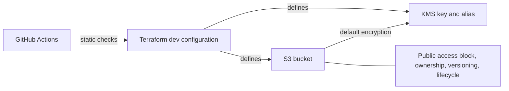

# Secure AWS Platform

[](https://github.com/jayekwere/secure-aws-platform/actions/workflows/terraform-security.yml)

A Terraform S3/KMS security lab with public access blocking, ACLs disabled, versioning, default customer-managed KMS encryption, lifecycle rules, and automated static checks.

**Current scope:** one single-region development configuration. IAM policies, private networking, logging, detection, OIDC, containers, and EKS are future work. This repository does not yet implement a complete application platform.

## Architecture defined in code

`terraform/environments/dev` is the only Terraform root module. It defines one S3 bucket, its configuration resources, a KMS key and alias, and a random bucket-name suffix. There are no reusable child modules or application workloads.



The workflow validates source code; it does not deploy to AWS. The diagram describes the configuration, not independently observed live resources.

## Implemented controls

These settings are defined in Terraform. Live configuration must be checked separately.

| Control | Configuration | Source |
| --- | --- | --- |
| S3 public access | All four bucket public-access-block settings are `true` | [main.tf](terraform/environments/dev/main.tf) |
| Object ownership | `BucketOwnerEnforced` disables ACL-based access control | [main.tf](terraform/environments/dev/main.tf) |
| Recovery from overwrite/deletion | Object versioning is enabled | [main.tf](terraform/environments/dev/main.tf) |
| Default object encryption | `aws:kms` using the project key; S3 Bucket Key enabled | [main.tf](terraform/environments/dev/main.tf) |
| Key management | Customer-managed KMS key, alias, automatic rotation | [kms.tf](terraform/environments/dev/kms.tf) |
| Storage lifecycle | Abort incomplete multipart uploads after 7 days; expire noncurrent versions after 30 days | [lifecycle.tf](terraform/environments/dev/lifecycle.tf) |
| Provider reproducibility | Provider constraints and a committed dependency lockfile | [versions.tf](terraform/environments/dev/versions.tf), [lockfile](terraform/environments/dev/.terraform.lock.hcl) |
| Automated static validation | Terraform formatting/validation, TFLint, blocking Checkov scan with four resource-scoped suppressions | [workflow](.github/workflows/terraform-security.yml), [suppression decisions](docs/phase-1-secure-s3-foundation.md#checkov-finding-decisions) |

Public access blocking does not define which authenticated identities should have access. Default encryption does not require every upload to use the project key or migrate existing objects. Those access and encryption policy boundaries remain to be implemented.

## Verification status

The October 25, 2026 source review covered [commit f34d2dc](https://github.com/jayekwere/secure-aws-platform/tree/f34d2dc1ca354be9c1cc766cf2fb586360ef806e).

| Evidence | Result and limit |
| --- | --- |
| [Hosted workflow run](https://github.com/jayekwere/secure-aws-platform/actions/runs/40050245606), October 23, 2026, Vancouver time | All three jobs passed. Checkov reported 18 passed, 0 failed, 4 skipped. This is a dated result, not a count guaranteed for future scanner versions. |
| Local source validation, October 25, 2026 | Formatting, backend-disabled initialization with the lockfile read-only, and provider validation passed using Terraform 1.15.8. No AWS account was accessed. |
| Historical manual deployments | The [learning log](docs/learning-log.md) records deployments and AWS CLI verification in July and August. Raw AWS verification output is not committed. |
| Current AWS environment | Not rechecked during the October 25 review. The repository does not establish whether the lab is currently deployed or whether live controls have drifted. |

There are no committed Terraform test suites, deliberately insecure regression fixtures, authorization integration tests, or automated drift checks. A passing static scan does not establish that unauthorized operations are denied.

## Run the static checks

Run from the repository root. Terraform 1.15.8 matches the workflow; [versions.tf](terraform/environments/dev/versions.tf) declares the supported range. Provider downloads require network access. These commands do not require AWS credentials or deploy infrastructure.

```sh
terraform fmt -check -recursive terraform
terraform -chdir=terraform/environments/dev init -backend=false -input=false -lockfile=readonly
terraform -chdir=terraform/environments/dev validate -no-color
```

To run the remaining checks locally, install TFLint 0.64.0 and Checkov. The recorded hosted run used Checkov 3.3.30; the workflow uses mutable action tags, so future runs can resolve different dependencies.

```sh
tflint --chdir=terraform/environments/dev --init --config="$PWD/.tflint.hcl"
tflint --chdir=terraform/environments/dev --config="$PWD/.tflint.hcl" --format=compact
checkov -d terraform/environments/dev --framework terraform
```

TFLint currently enables only the Terraform recommended ruleset, not the AWS ruleset. Checkov fails on unsuppressed findings; its four documented suppressions remain active. The workflow retains console output but does not upload verification artifacts.

For read-only AWS checks against an existing lab, see the [phase notes](docs/phase-1-secure-s3-foundation.md#read-only-aws-verification).

## Lab boundaries and deferred controls

- **Destructive teardown:** `force_destroy = true` allows Terraform to delete the bucket's contents, including object versions. The KMS key has a 7-day deletion window. Versioning and lifecycle rules are not an immutable backup or retention guarantee.
- **Development scope:** the environment variable accepts `dev`, `test`, and `prod`, but changes names and tags without adding production safeguards or environment isolation. Use this configuration only for disposable development data.
- **External identity assumptions:** the provider uses externally supplied AWS credentials. It does not enforce the documented historical role, an expected account ID, or least-privilege reader/writer access. No IAM or explicit KMS key policy is managed here.
- **Missing bucket policy:** there is no bucket-wide HTTPS deny or policy requiring the intended KMS key. SSE-KMS object requests themselves require TLS; this is a broader policy gap, not evidence that those requests use plaintext.
- **Local state:** there is no remote backend or shared state recovery process. [Ignore rules](.gitignore) exclude state, saved plans, and common credential files; they do not prevent forced commits or replace secret scanning.
- **Deferred observability:** S3 access logging, CloudTrail configuration, EventBridge notifications, alerts, and remediation are absent. Any account-level controls configured elsewhere are outside this repository's evidence.
- **Validation and review limits:** no negative-test evidence, workflow dependency lockfile or SHA-pinned actions, or exception-expiry enforcement is present. The October 25 review found no branch protection or repository rulesets enforcing checks and review.

See the [phase notes](docs/phase-1-secure-s3-foundation.md) for control details, historical deployment claims, and the individual Checkov decisions.

## Prioritized planned work

All items below are planned; none is implemented by this documentation update.

| Priority | Work | Completion evidence |
| --- | --- | --- |
| 1 | Define S3/KMS reader, writer, and administrator permissions; enforce transport/encryption requirements; add account and development-only safeguards | Allowed operations succeed and unauthorized operations fail in a disposable lab |
| 2 | Add negative regression tests, reproducible verification output, immutable workflow dependencies, and required checks/review | Intentionally weakened configurations fail CI; dated, sanitized results can be inspected |
| 3 | Add a separately bootstrapped remote state backend and scoped OIDC for trusted workflows that need AWS access | State locking/recovery and permitted/denied role assumptions are demonstrated |
| 4 | Complete one CloudTrail/EventBridge detection and documented restoration scenario | A controlled bucket security configuration change produces an observable event and verified restoration |

Private networking, reusable modules, container scanning, EKS, Kubernetes policies, and admission control remain longer-term possibilities outside the current S3/KMS milestone.

## Project notes

- [Phase 1: S3/KMS configuration, tradeoffs, and verification](docs/phase-1-secure-s3-foundation.md)
- [Historical learning log](docs/learning-log.md)
- [Project presentation and proposed repository description](docs/project-presentation.md)

Use synthetic development data. Keep credentials, private keys, Terraform state, and saved plans out of source control.
