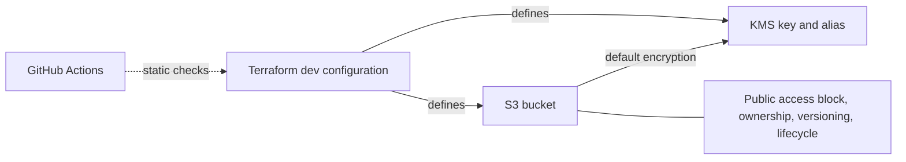

# Secure AWS Platform

[](https://github.com/jayekwere/secure-aws-platform/actions/workflows/terraform-security.yml)

A Terraform S3/KMS security lab with public access blocking, ACLs disabled, versioning, default customer-managed KMS encryption, lifecycle rules, and automated static checks.

**Current scope:** one single-region development configuration. IAM policies, private networking, logging, detection, OIDC, containers, and EKS are future work. This repository does not yet implement a complete application platform.

**Deployed milestone, October 26, 2026:** the reviewed deny-only bucket policy and safer teardown setting are applied to the existing bucket. Twenty verification checks passed, including real allow/deny requests and multipart uploads; the final Terraform plan reported no changes. See the [request contract and verification record](docs/storage-policy-contract.md). Hosted CI has not run these local changes.

## Architecture defined in code

`terraform/environments/dev` is the only Terraform root module. It defines one S3 bucket, its configuration resources, a KMS key and alias, and a random bucket-name suffix. There are no reusable child modules or application workloads.



The workflow validates source code; it does not deploy to AWS. The diagram describes the configuration, not independently observed live resources.

## Implemented controls

These settings are defined in Terraform. Live configuration must be checked separately.

| Control | Configuration | Source |
| --- | --- | --- |
| S3 public access | All four bucket public-access-block settings are `true` | [main.tf](terraform/environments/dev/main.tf) |
| Object ownership | `BucketOwnerEnforced` disables ACL-based access control | [main.tf](terraform/environments/dev/main.tf) |
| Recovery from overwrite/deletion | Object versioning is enabled | [main.tf](terraform/environments/dev/main.tf) |
| Default object encryption | `aws:kms` using the project key; S3 Bucket Key enabled | [main.tf](terraform/environments/dev/main.tf) |
| Key management | Customer-managed KMS key, alias, automatic rotation | [kms.tf](terraform/environments/dev/kms.tf) |
| Bucket request policy | Deny non-service HTTP requests and uploads without explicit SSE-KMS/project-key selection | [bucket-policy.tf](terraform/environments/dev/bucket-policy.tf) |
| Storage lifecycle | Abort incomplete multipart uploads after 7 days; expire noncurrent versions after 30 days | [lifecycle.tf](terraform/environments/dev/lifecycle.tf) |
| Provider reproducibility | Provider constraints and a committed dependency lockfile | [versions.tf](terraform/environments/dev/versions.tf), [lockfile](terraform/environments/dev/.terraform.lock.hcl) |
| Automated validation | Terraform formatting/validation, TFLint, blocking Checkov scan, and local mocked regression tests configured for CI | [workflow](.github/workflows/terraform-security.yml), [test runner](scripts/check_storage_regressions.py), [suppression decisions](docs/phase-1-secure-s3-foundation.md#checkov-finding-decisions) |

Public access blocking and the deny-only policy do not define which authenticated identities should have access. The new policy requires explicit encryption headers after deployment; default encryption alone does not. Existing objects are not migrated.

## Verification status

The October 25, 2026 source review covered [commit f34d2dc](https://github.com/jayekwere/secure-aws-platform/tree/f34d2dc1ca354be9c1cc766cf2fb586360ef806e).

| Evidence | Result and limit |
| --- | --- |
| [Hosted workflow run](https://github.com/jayekwere/secure-aws-platform/actions/runs/40050245606), October 23, 2026, Vancouver time | All three jobs passed. Checkov reported 18 passed, 0 failed, 4 skipped. This is a dated result, not a count guaranteed for future scanner versions. |
| Local source validation, October 25, 2026 | Formatting, backend-disabled initialization with the lockfile read-only, and provider validation passed using Terraform 1.15.8. No AWS account was accessed. |
| Historical manual deployments | The [learning log](docs/learning-log.md) records deployments and AWS CLI verification in July and August. Raw AWS verification output is not committed. |
| Local storage tests, October 26, 2026 | Four mocked plan tests passed; all seven deliberate regressions were detected. [Results and source hashes](docs/evidence/storage-policy-tests-local.json). These are configuration tests, not live AWS authorization tests. |
| Local lint/security scans, October 26, 2026 | [TFLint 0.64.0](docs/evidence/storage-tflint-local.json) reported no issues. [Checkov 3.3.30](docs/evidence/storage-checkov-local.json) reported 19 passed, 0 failed, 4 skipped, and 0 parsing errors. Both ran with read-only source mounts and container networking disabled. |
| Read-only AWS console inspection, October 25, 2026 | The existing lab bucket was found in Ohio. This was a pre-deployment inspection of selected controls. [Scope](docs/storage-policy-contract.md#read-only-console-observations). |
| Applied controls and live verification, October 26, 2026 | [Twenty checks passed](docs/evidence/storage-live-verification.json): approved-key uploads/downloads, different-key and missing-header denials, anonymous-read denial, multipart compatibility, account guard, and control queries. Synthetic versions were removed. The post-apply Terraform plan reported no changes. |

Mocked tests cover configuration regressions. A separate live verification used the existing administrator role and synthetic objects; it does not prove least-privilege workload roles. Automated drift checks remain absent.

## Run the static checks

Run from the repository root. Terraform 1.15.8 matches the workflow; [versions.tf](terraform/environments/dev/versions.tf) declares the supported range. Provider downloads require network access. These commands do not require AWS credentials or deploy infrastructure.

```sh
terraform fmt -check -recursive terraform
terraform -chdir=terraform/environments/dev init -backend=false -input=false -lockfile=readonly
terraform -chdir=terraform/environments/dev validate -no-color
terraform -chdir=terraform/environments/dev test -no-color
```

To run the remaining checks locally, install TFLint 0.64.0 and Checkov. The recorded hosted run used Checkov 3.3.30; the workflow uses mutable action tags, so future runs can resolve different dependencies.

```sh
tflint --chdir=terraform/environments/dev --init --config="$PWD/.tflint.hcl"
tflint --chdir=terraform/environments/dev --config="$PWD/.tflint.hcl" --format=compact
checkov -d terraform/environments/dev --framework terraform
```

TFLint currently enables only the Terraform recommended ruleset, not the AWS ruleset. Checkov fails on unsuppressed findings; its four documented suppressions remain active. The workflow retains console output but does not upload verification artifacts.

To run the mocked tests and prove all seven deliberately weakened configurations fail the intended assertions:

```sh
python3 scripts/check_storage_regressions.py
```

For read-only AWS checks against an existing lab, see the [phase notes](docs/phase-1-secure-s3-foundation.md#read-only-aws-verification).

## Lab boundaries and deferred controls

- **Destructive teardown:** automatic removal of bucket contents is disabled by default. Explicit `allow_force_destroy = true` permits removal of contents and versions. This does not prevent deleting an empty bucket or scheduling key deletion; the KMS deletion window remains 7 days. These settings do not establish immutable retention or a backup strategy.
- **Development scope:** the root module accepts only `dev`. Use disposable development data.
- **External identity assumptions:** the provider requires `expected_account_id` and rejects other accounts, but credentials and role assumption remain external. No reader/writer IAM roles or explicit KMS key policy are managed here.
- **Live request contract:** uploads need explicit SSE-KMS and a key identifier resolving to the approved key. AWS accepts an alias for that same key. Other existing keys, missing headers, and SSE-S3 requests were rejected. Signed HTTP requests were not sent; the transport deny was verified in the applied policy.
- **Local state:** the recovered state in this checkout is now authoritative; the original checkout's state remains an unchanged pre-apply archive. Use this checkout for subsequent Terraform operations. There is no remote backend or shared recovery process. [Ignore rules](.gitignore) exclude state and plans from ordinary Git adds.
- **Deferred observability:** S3 access logging, CloudTrail configuration, EventBridge notifications, alerts, and remediation are absent. Any account-level controls configured elsewhere are outside this repository's evidence.
- **Validation and review limits:** the new tests have local evidence only. Workflow dependency locking/SHA pins and exception-expiry enforcement remain absent. The October 25 review found no branch protection or repository rulesets enforcing checks and review.

See the [phase notes](docs/phase-1-secure-s3-foundation.md) for control details, historical deployment claims, and the individual Checkov decisions.

## Prioritized planned work

The original state was recovered, matched to AWS, and used to update the existing resources without replacements or deletions. The active state and private backups are ignored by Git. Remaining planned work:

| Priority | Work | Completion evidence |
| --- | --- | --- |
| 1 | Define S3/KMS workload reader/writer and administrator permissions, including an explicit key policy | Least-privilege role tests pass alongside the deployed request-policy checks |
| 2 | Run the new tests in hosted CI, add immutable workflow dependencies and required checks/review | Intentionally weakened configurations fail hosted CI; dated, sanitized results can be inspected |
| 3 | Add a separately bootstrapped remote state backend and scoped OIDC for trusted workflows that need AWS access | State locking/recovery and permitted/denied role assumptions are demonstrated |
| 4 | Complete one CloudTrail/EventBridge detection and documented restoration scenario | A controlled bucket security configuration change produces an observable event and verified restoration |

Private networking, reusable modules, container scanning, EKS, Kubernetes policies, and admission control remain longer-term possibilities outside the current S3/KMS milestone.

## Project notes

- [Phase 1: S3/KMS configuration, tradeoffs, and verification](docs/phase-1-secure-s3-foundation.md)
- [Historical learning log](docs/learning-log.md)
- [Storage policy milestone and live inspection scope](docs/storage-policy-contract.md)
- [Project presentation and proposed repository description](docs/project-presentation.md)

Use synthetic development data. Keep credentials, private keys, Terraform state, and saved plans out of source control.
